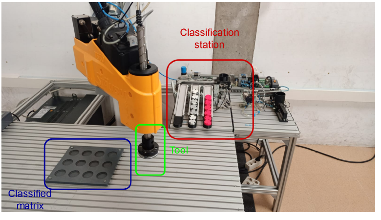
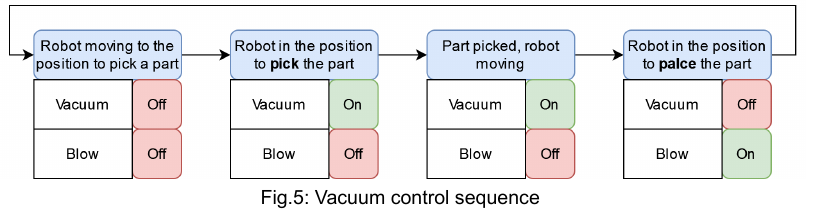

# Guía de comprensión de Lab 2A: Pick and Place con el Stäubli TS60

**Del enunciado al código de Level 3 y a la simulación manual**

Fecha de recopilación: 25 de octubre de 2026.

Esta guía reúne las explicaciones de la conversación desde que retomamos la práctica desde el principio. Mantiene el detalle, los ejemplos y el orden de aprendizaje; cada sección principal corresponde aproximadamente a una explicación del chat. Las explicaciones del recorrido manual se han unificado en el capítulo 19, conservando el detalle y destacando las acciones que debe hacer el usuario.

El punto de partida es **el enunciado de la práctica y los códigos que tenemos en Stäubli**, no una memoria redactada por el grupo. Esta guía es material de estudio; no es el informe de entrega ni demuestra por sí misma que se haya validado el robot físico.

**Cómo leer los nombres:** comenzamos explicando el programa con nombres anteriores como `nType`, `pPick` o `tTool`. Después los cambiamos por `materialType`, `pickPose` y `vacuumTool`. Los ejemplos iniciales conservan aquellos nombres para mantener las explicaciones prácticamente como se dieron; la sección 14 incluye la equivalencia completa. No hay que crear ambas versiones de una variable.

**Cómo leer la evolución de la simulación:** al empezar, solo estaban activos los movimientos y los sensores estaban comentados. Más adelante se preparó una aplicación distinta de la física, que espera cambios manuales de los detectores. Por eso las primeras explicaciones dicen «ahora está comentado» o «más adelante lo simularemos». Esas frases describen aquel punto del aprendizaje; la configuración más reciente está explicada desde la sección 14.

Las imágenes se han extraído del enunciado `lesson2a.pdf`. Las funciones de sensores indicadas como procedentes del enunciado se distinguen de las hipótesis sobre polaridades y rutas, que siguen teniendo TODOs de comprobación física.

## Índice

1. Punto de partida y forma de trabajar.
2. La célula: estación clasificadora, herramienta y matriz.
3. La ventosa: vacío y soplado.
4. Confirmar que se ha sujetado una pieza.
5. Alimentación y movimiento del carro.
6. Presencia y detección del material.
7. La barrera: retener antes de decidir.
8. Los actuadores y la selección de la rampa.
9. Los finales de carrera.
10. Detectar el paso hacia la rampa.
11. Recogida: aproximación y contacto.
12. Recogida completa: joints, movimientos y esperas.
13. Preferencias acordadas para organizar el código.
14. Reorganización: nombres claros y dos aplicaciones.
15. Qué aplicación está abierta y cómo abrir la física.
16. La herramienta y el TCP.
17. Contadores y selección de huecos.
18. Generación cinemática de la matriz de joints.
19. Recorrido completo de simulación manual: acciones y explicación por fase.
20. Corrección de los enlaces de las herramientas.
21. Estado actual y puntos que todavía hay que aclarar o comprobar.

## 1. Punto de partida y forma de trabajar

Vamos desde cero, una cosa cada vez. Utilizamos **el enunciado para entender qué se pide** y **el código guardado para comprobar cómo lo hemos planteado**.

Cuando hablamos de «informe» al comienzo de esta revisión, nos referimos al enunciado de la práctica, no a una memoria propia del grupo.

Separamos dos cuestiones:

- **El funcionamiento físico:** piezas reales, sensores, vacío, carro, barrera y actuadores.
- **La simulación para aprender:** puede ser sencilla y no necesita piezas animadas. Podemos representar las interacciones modificando manualmente variables mientras el programa se ejecuta.

Al comenzar esta revisión, el `start` guardado alternaba automáticamente las recogidas y tenía comentadas las interacciones físicas. Permitía estudiar el recorrido del brazo, pero todavía no esperaba que el usuario cambiase detectores manualmente.

La propuesta de modificar variables durante la ejecución sirve para representar esos detectores: el programa puede esperar «hay pieza», «el actuador ya llegó» o «la ventosa ya sujeta», aunque no existan esas interacciones en la escena 3D.

## 2. La célula: estación clasificadora, herramienta y matriz

Empezamos por la **figura 1, página 3 del PDF, numerada como 2**. Aparecen tres elementos:

| Elemento | Para qué sirve |
|---|---|
| **Estación clasificadora** | Suministra las piezas y permite separarlas según su material. |
| **Herramienta del robot** | Es una ventosa: sujeta la pieza mediante vacío para transportarla. |
| **Matriz de destino** | Es la placa con huecos donde el robot deposita las piezas. |



La distinción importante es esta: **la estación conduce las piezas hacia las rampas; el brazo las recoge de las rampas y las lleva a la matriz**. Son dos partes distintas del proceso.

En la simulación de movimientos que teníamos inicialmente solo estaban activos los movimientos del brazo. Eso permitía estudiar sus recorridos, pero todavía no representaba el funcionamiento de la estación clasificadora.

El usuario confirmó que identificaba en la imagen la estación con las rampas y, por separado, la placa de destino.

## 3. La ventosa: vacío y soplado

Lo siguiente es **la herramienta**, apartado 2.2 del enunciado.

El TS60 utiliza una **ventosa**, no una pinza que abra y cierre dedos. Para sujetar una pieza, crea vacío entre la ventosa y su superficie.

Hay dos acciones diferentes:

| Acción | Qué ocurre |
|---|---|
| **Aspirar** | Se activa el vacío para sujetar la pieza. |
| **Soplar** | Se introduce aire para facilitar que la pieza se desprenda. |

Por eso necesitamos **dos salidas distintas**:

- `bOut0`: controla el **vacío**.
- `bOut1`: controla el **soplado**.

Apagar el vacío y activar el soplado **no son la misma acción**. La secuencia de la figura 5 es:

```text
Acercarse:    vacío OFF, soplado OFF
Recoger:      vacío ON,  soplado OFF
Transportar:  vacío ON,  soplado OFF
Depositar:    vacío OFF, soplado ON
```

Después se apaga el soplado para la siguiente recogida. Esto corresponde a las figuras 3–5 del enunciado.



En el código de simulación de movimientos, esas órdenes estaban comentadas: **el brazo reproducía el recorrido, pero no se estaba comprobando que sujetase una pieza**.

La diferencia que debemos tener clara es **vacío para sujetar** y **soplado para soltar**.

## 4. Confirmar que se ha sujetado una pieza

Ahora, **cómo sabemos si la ventosa ha conseguido sujetar la pieza**.

El enunciado asigna esa detección a **`bIn0`**, una entrada digital:

| Valor | Significado |
|---|---|
| `false` — 0 | No se detecta una pieza sujeta. |
| `true` — 1 | Se detecta una pieza sujeta. |

La diferencia con lo anterior es importante:

- **`bOut0` es una orden:** «activa el vacío».
- **`bIn0` es una lectura:** «se detecta una pieza sujeta».

**Ordenar aspirar no garantiza haber recogido la pieza.** Puede faltar la pieza o no haber buen contacto con la ventosa. Esa distinción aparece en el mapa de señales del enunciado.

Por eso la parte física del código hacía:

```text
bOut0 = true
if !watch(bIn0 == true, 3)
  putln("ERROR: no suction confirmation")
  return
endIf
```

Significa: **activar el vacío y esperar hasta tres segundos a la confirmación**. Si no llega, mostrar el error y salir de esa rutina.

En aquel momento estaba comentado para simular sin piezas. La idea para la simulación interactiva es representar esa confirmación cambiando manualmente una variable durante la ejecución.

La diferencia que debemos comprender es **mandar una salida** frente a **leer una entrada**.

En los nombres actuales, esta relación es:

```text
vacuumOn     // Orden de aspiración; equivalente a bOut0.
partOnTool   // Detección de pieza sujeta; equivalente a bIn0.
```

## 5. Alimentación y movimiento del carro

Pasamos al **inicio de la estación clasificadora**: de dónde salen las piezas.

El enunciado muestra una **torre de alimentación**, donde se introducen las piezas, y un **carro** que las transporta hacia la zona de clasificación.

Aquí aparecen otras dos señales:

| Señal | Tipo | Qué significa |
|---|---|---|
| `bIn3` | Entrada | Detecta una pieza preparada en la alimentación. |
| `bOut2` | Salida | Ordena mover o detener el carro: `1` mueve, `0` detiene. |

Son el **sensor de presencia 1** y el control del carro, descritos en los apartados 2.3 y 2.5 del enunciado.

La idea es:

```text
¿Hay una pieza preparada en la alimentación?
                 ↓ sí
         Ordenar mover el carro
```

**Ojo con los nombres:** «sensor de presencia 1» corresponde a **`bIn3`**, no a `bIn1`. La numeración del nombre del sensor no coincide con la numeración de las entradas.

Y distinguimos ya dos detecciones:

- **`bIn3`**: hay una pieza **en la alimentación**.
- **`bIn0`**: hay una pieza **sujeta en la ventosa**.

En una simulación con interacción manual, cambiamos una variable que represente `bIn3` para decirle al programa: **«ya hay una pieza disponible»**. Eso permite practicar la lógica incluso sin piezas animadas.

Sus nombres actuales son:

```text
partAtSource   // Sensor de pieza disponible en la alimentación.
trolleyOn      // Orden de movimiento del carro.
```

## 6. Presencia y detección del material

Cuando el carro lleva la pieza a la **zona de clasificación**, necesitamos saber dos cosas: **si ha llegado** y **si es metálica**.

Para eso hay dos sensores:

| Señal | Qué detecta |
|---|---|
| **`bIn1`** | Presencia de una pieza en la zona de clasificación. Es el «sensor de presencia 2» del dibujo. |
| **`bIn2`** | Si la pieza es metálica, mediante el sensor inductivo. |

Estos sensores aparecen en los apartados 2.3 y 2.5 del enunciado.

La interpretación es:

| `bIn1`: presencia | `bIn2`: metal | Qué podemos concluir |
|---:|---:|---|
| 1 | 1 | Hay una pieza y es metálica. |
| 1 | 0 | Hay una pieza y se interpreta como no metálica. |
| 0 | 0 | No se detecta pieza; **no significa que haya una no metálica**. |

**Primero confirmamos presencia y después leemos el material.** Un inductivo apagado por sí solo no distingue entre «pieza no metálica» y «no hay ninguna pieza».

En la simulación manual representamos la llegada poniendo la presencia a `true` y elegimos el material poniendo la detección de metal a `true` o `false`.

Al explicar esto por primera vez, todavía no habíamos añadido ese comportamiento al código activo. En la versión actual usamos:

```text
partAtClass   // Presencia en clasificación; equivalente a bIn1.
partIsMetal   // Lectura del inductivo; equivalente a bIn2.
```

Debemos seleccionar `partIsMetal` antes de confirmar `partAtClass=true`, porque el programa interpreta el material después de recibir esa confirmación de llegada.

## 7. La barrera: retener antes de decidir

Ahora necesitamos **mantener la pieza en la zona de clasificación mientras decidimos hacia qué rampa enviarla**. Para eso está la **barrera**.

La barrera es un tope físico: retiene la pieza y después permite que continúe.

Su salida de control es **`bOut5`**, según el mapa del enunciado.

El orden lógico es:

```text
Retener la pieza con la barrera
              ↓
Confirmar presencia y leer el material
              ↓
Preparar la ruta hacia la rampa correspondiente
              ↓
Liberar la pieza
```

**La barrera no detecta el material ni elige la rampa.** Su función es controlar cuándo puede pasar la pieza.

En el código físico elegimos esta hipótesis:

```text
// Retener la pieza.
bOut5 = true

// Liberar la pieza.
bOut5 = false
```

Esa polaridad fue una decisión de implementación pendiente de comprobar en la estación; el enunciado identifica la salida, pero no aclara qué estado abre o cierra.

Para simular la lógica manualmente, basta con entender que hay dos estados: **pieza retenida** y **pieza liberada**. El programa puede representarlos sin accionar una salida física.

### Acuerdo: TODO sobre la polaridad de la barrera

Se acordó dejar indicado en el código:

```text
// TODO FÍSICO: comprobar polaridad de bOut5.
// Suponemos 1 = retener y 0 = liberar.
// Si físicamente es al revés, invertir ambas órdenes de forma coherente.
```

La revisión debe incluir las órdenes del arranque, el ciclo, las salidas por fallo y la parada; no basta con invertir solo una de ellas.

En la versión con nombres descriptivos, la orden es `barrierClosed`. En simulación expresa lógicamente «barrera cerrada». En físico sigue pendiente comprobar que escribir `true` en su salida realmente produce ese estado.

## 8. Los actuadores y la selección de la rampa

Seguimos con **los dos actuadores de clasificación**: los mecanismos que preparan el camino hacia cada rampa.

| Salida | Qué controla |
|---|---|
| `bOut3` | Actuador de clasificación 1. |
| `bOut4` | Actuador de clasificación 2. |

Así los identifica el enunciado. El usuario aclaró además:

- **Class-actuator 1:** piezas no metálicas rojas, rampa de la derecha.
- **Class-actuator 2:** piezas metálicas.

Cada actuador puede estar **extendido o retraído**. La combinación de sus posiciones prepara la ruta de la pieza.

En el código físico elegimos:

| Material | `bOut3` | `bOut4` |
|---|---:|---:|
| No metálico | 1 | 0 |
| Metálico | 0 | 1 |

**Esta tabla es nuestra hipótesis de funcionamiento, todavía pendiente de comprobar físicamente.**

Lo importante es el orden: **primero posicionamos los actuadores y después abrimos la barrera**. Así, cuando liberamos la pieza, su camino ya está preparado.

### Acuerdo: TODO sobre extender y empujar

Se añadió el TODO de verificar que **`bOut3=1` y `bOut4=1` extienden o empujan sus respectivos actuadores**.

Además de comprobar la polaridad, hay que confirmar que la combinación de ambos actuadores conduce a la rampa prevista. Saber qué actuador corresponde a una rampa no elimina la necesidad de revisar la posición del otro.

Los nombres actuales de sus órdenes son:

```text
nonMetalGate   // Orden del actuador 1; equivalente a bOut3.
metalGate      // Orden del actuador 2; equivalente a bOut4.
```

## 9. Los finales de carrera

Lo siguiente es **cómo sabemos que los actuadores han llegado a su posición**. Cada uno tiene dos sensores de final de carrera:

| Actuador | Detecta extensión | Detecta retracción |
|---|---|---|
| 1 — no metálicas | `bIn5` | `bIn6` |
| 2 — metálicas | `bIn7` | `bIn8` |

Estas funciones están indicadas en el mapa de señales del enunciado.

Por ejemplo, para el actuador 1:

```text
Ordenamos extenderlo
        ↓
Esperamos bIn5=1 y bIn6=0
        ↓
Su posición extendida está confirmada
```

**Mandar la salida no confirma que el mecanismo haya terminado de moverse.** Estos sensores permiten esperar esa confirmación antes de abrir la barrera.

Durante el recorrido puede haber un momento con ambos sensores a `0`: todavía no está en ninguno de los extremos. En nuestra simulación manual podemos representar precisamente eso: primero «moviéndose» y después «posición alcanzada».

Los nombres actuales son:

| Señal | Nombre actual |
|---|---|
| `bIn5` | `gate1Extended` |
| `bIn6` | `gate1Retracted` |
| `bIn7` | `gate2Extended` |
| `bIn8` | `gate2Retracted` |

## 10. Detectar el paso hacia la rampa

Una vez preparada la ruta, **abrimos la barrera y la pieza avanza hacia su rampa**. Ahora necesitamos detectar que ha pasado.

Para eso está el **sensor de presencia 3**, cuya señal es **`bIn4`**:

| Valor | Significado |
|---|---|
| `1` | El sensor detecta una pieza pasando por su zona. |
| `0` | Su zona de detección está libre. |

El enunciado lo describe como el sensor que se activa cuando una pieza baja por una de las rampas.

El paso completo debería producir esta secuencia:

```text
bIn4 = 0     Zona libre antes de liberar.
bIn4 = 1     La pieza pasa por el sensor.
bIn4 = 0     La pieza deja atrás el sensor.
```

**Esto confirma el paso por el sensor, no que la pieza ya haya llegado al lugar donde la recoge la ventosa.**

En el código físico dejamos una espera adicional de **0,5 segundos** después del paso. Ese tiempo fue una propuesta inicial: habrá que comprobar físicamente cuánto tarda en llegar y quedar quieta.

En la simulación manual representamos el paso cambiando su variable de **0 → 1 → 0**. Así podemos entender cómo responde el programa sin necesitar una pieza animada.

El nombre actual de esa variable es:

```text
partAtRamp   // Equivalente a bIn4: detección del paso por la rampa.
```

En nuestra simulación simplificada, al dejar libres el paso y la clasificación damos también por hecho que la pieza ya puede recogerse. Es una simplificación de la simulación, no una medición adicional del sensor físico.

## 11. Recogida: aproximación y contacto

Ahora entra en juego **el brazo del robot**: la pieza ya está en su rampa y hay que recogerla con la ventosa.

Para cada rampa tenemos guardadas **dos posturas**:

| Nombre anterior | Para qué sirve | Nombre actual |
|---|---|---|
| `pApproachPick` | Situar la ventosa separada de la pieza, antes de acercarse. | `pickApproach` |
| `pPick` | Situar la ventosa en la posición de recogida, donde debe contactar con la pieza. | `pickPose` |

Como hay dos rampas, cada variable tiene dos elementos:

- **`[0]`**: recogida de la no metálica.
- **`[1]`**: recogida de la metálica.

Esa es la correspondencia elegida en el código. **El usuario confirmó durante la revisión que coincide con dónde están enseñadas las posturas.**

La secuencia es:

```text
Ir a la aproximación de recogida
        ↓
Acercarse hasta la postura de recogida
        ↓
Activar vacío y confirmar pieza sujeta
        ↓
Retirarse hasta la aproximación
```

**La aproximación sirve también como retirada.** No queremos empezar a desplazarnos hacia la matriz cuando la pieza todavía está encajada o rodeada por los bordes de la rampa.

Un detalle de los nombres originales: aunque empezaban por `p`, **`pPick` y `pApproachPick` eran variables de tipo `jointRs`**. Guardan las posiciones de los cuatro ejes del TS60; el prefijo del nombre no determina el tipo de dato. Después se renombraron como `pickPose` y `pickApproach`, manteniendo el tipo `jointRs`.

## 12. Recogida completa: joints, movimientos y esperas

Recorremos ahora **la recogida completa**, relacionando las variables con las instrucciones.

### 12.1. El material elige la rampa

En los nombres anteriores habíamos fijado:

```text
// No metálica.
nType = 0

// Metálica.
nType = 1
```

Por eso:

```text
pPick[nType]
```

seleccionaba `pPick[0]` o `pPick[1]`. Lo mismo ocurría con `pApproachPick[nType]`.

`nType` **solo guardaba la clasificación**, no detectaba nada por sí mismo. En físico se obtiene leyendo el inductivo; en la simulación de movimientos original se alternaba automáticamente. Más adelante sustituimos esa alternancia por nuestra interacción manual.

Con los nombres actuales:

```text
pickPose[materialType]
pickApproach[materialType]
```

### 12.2. Qué guarda una jointRs

Es una postura de los cuatro ejes del TS60:

| Componente | Qué representa | Unidad |
|---|---|---|
| `J1` | Giro de la primera articulación. | Grados. |
| `J2` | Giro de la segunda articulación. | Grados. |
| `J3` | Posición del eje lineal de subida/bajada. | Milímetros. |
| `J4` | Giro del eje final de la herramienta. | Grados. |

**No son las coordenadas X, Y, Z de la ventosa.** El controlador calcula dónde queda esta a partir de las articulaciones y de la geometría del robot.

Los valores guardados que revisamos eran:

| Rampa | J3 en aproximación | J3 en recogida |
|---|---:|---:|
| No metálica `[0]` | 100 | 23,19 |
| Metálica `[1]` | 100 | 25,69 |

En cada pareja se mantienen J1, J2 y J4. Por tanto, la aproximación y recogida se diferencian únicamente en la posición del eje lineal. Ya no tenemos la antigua separación de solo 0,1 mm que existió en una versión anterior.

### 12.3. Cómo se acerca el robot

Primero ejecutábamos:

```text
movej(pApproachPick[nType], tTool, mNomSpeed)
waitEndMove()
```

En la versión actual:

```text
movej(pickApproach[materialType], vacuumTool, moveSpeed)
waitEndMove()
```

`movej` ordena un movimiento **articular** hasta la postura de aproximación. La trayectoria de la ventosa no tiene por qué ser una línea recta.

Los tres argumentos son:

| Argumento actual | Qué aporta |
|---|---|
| `pickApproach[materialType]` | El destino. |
| `vacuumTool` | La definición de nuestra herramienta. |
| `moveSpeed` | Los parámetros de movimiento. |

Luego entramos hasta la pieza. La instrucción original era:

```text
movel(jointToPoint(tTool, world, pPick[nType]), tTool, mNomSpeed)
waitEndMove()
```

Ahora se escribe:

```text
movel(jointToPoint(vacuumTool, world, pickPose[materialType]), vacuumTool, moveSpeed)
waitEndMove()
```

Aquí usamos **`movel` para que el TCP siga una línea recta**. El TCP es el punto de la herramienta cuya posición controla el robot; queremos que represente el punto de trabajo de la ventosa.

Como la recogida está guardada como joint, hacemos esta conversión:

```text
jointToPoint(vacuumTool, world, pickPose[materialType])
```

Significa:

> «Calcula dónde quedaría el TCP de nuestra herramienta en esa postura articular y expresa el resultado respecto a world».

**Calcular eso no mueve el robot.** La orden que lo mueve es el `movel` exterior. Tampoco transforma permanentemente nuestra variable: `pickPose` sigue siendo una joint.

### 12.4. Por qué aparece waitEndMove después de cada movimiento

Las órdenes de movimiento permiten que el programa continúe preparando instrucciones antes de que el brazo llegue al destino.

```text
waitEndMove()
```

hace que esa tarea espere a que termine el movimiento. Así evitamos, por ejemplo, ordenar aspiración cuando la ventosa todavía está acercándose.

En físico, después venía:

```text
bOut0 = true
```

y la comprobación del sensor de vacío que ya vimos. En la simulación de movimientos original estaban comentadas, por lo que continuaba sin exigir una pieza. En la simulación manual actual se utiliza `vacuumOn=true` y se espera que el usuario confirme `partOnTool=true`.

Finalmente nos retiramos linealmente a la aproximación:

```text
movel(jointToPoint(vacuumTool, world, pickApproach[materialType]), vacuumTool, moveSpeed)
waitEndMove()
```

La lógica del recorrido es, por tanto:

```text
Movimiento articular hasta la aproximación
                    ↓
Entrada lineal hasta la pieza
                    ↓
Aspiración y confirmación
                    ↓
Retirada lineal hasta la aproximación
```

En físico la confirmación procede del sensor real. En simulación manual la representa el usuario. Solo la versión inicial de movimientos la omitía.

## 13. Preferencias acordadas para organizar el código

Durante la revisión se pidieron dos mejoras para facilitar el aprendizaje y el trabajo posterior.

La primera fue utilizar **nombres claros y explicativos**, por ejemplo `materialType` en lugar de `nType`, con comentarios que indiquen qué significa cada valor.

La segunda fue agrupar el código en bloques visuales y evitar tener que descomentar línea a línea una gran cantidad de código físico. Se acordó **separar la simulación con señales manuales del programa físico**.

El objetivo de la simulación manual no es volver a ejecutar solo movimientos sin detectores. Es representar el mismo proceso físico mediante variables que podamos modificar durante la ejecución.

Los comentarios de los bloques tienen esta forma:

```text
// ============================================================
// TÍTULO DEL BLOQUE
// ============================================================
```

Estos separadores organizan visualmente el código; no se utilizan para activar o desactivar funciones. La separación entre aplicaciones evita depender de comentarios de bloque para cambiar de simulación a físico.

También se mantuvo el criterio de **separar una rutina si se reutiliza varias veces**. Por eso la recogida y colocación tiene su propio programa: se llama para cada una de las ocho piezas.

## 14. Reorganización: nombres claros y dos aplicaciones

El código se reorganizó y quedó preparado para **simular la lógica de Level 3 mediante cambios manuales**. La preparación se hizo por archivos, sin controlar la interfaz ni ejecutar movimientos.

Se separaron dos aplicaciones:

- **`Lab2A`**: simulación manual, sin conexiones a pines físicos.
- **`Lab2A_Physical`**: misma secuencia con las E/S reales y los TODOs de comprobación física.

Cada una tiene solo tres programas:

| Programa | Contenido |
|---|---|
| `start` | Preparación, cálculo de joints, alimentación, clasificación y ciclo principal. |
| `pickAndPlace` | Recogida y colocación; se reutiliza para cada pieza. |
| `stop` | Parada. |

El código lleva separadores y comentarios que explican cada señal.

### 14.1. Equivalencia de nombres

| Nombre anterior | Nombre actual | Significado |
|---|---|---|
| `nType` | `materialType` | Material de la pieza actual: 0 no metálica, 1 metálica. |
| `nCount` | `placedCount` | Dos contadores de piezas colocadas, uno por material. |
| `nPlace` | `placeIndex` | Índice del hueco de destino, entre 0 y 7. |
| `bCycleOK` | `cycleOK` | Indica si la rutina de recogida y colocación terminó correctamente. |
| `pHome` | `homePose` | Postura de referencia para inicio y retorno. |
| `pPick` | `pickPose` | Dos joints de recogida. |
| `pApproachPick` | `pickApproach` | Dos joints de aproximación a las recogidas. |
| `pPlace` | `placePose` | Ocho joints de depósito en la matriz. |
| `pApproachPlace` | `placeApproach` | Ocho joints de aproximación a la matriz. |
| `tTool` | `vacuumTool` | Definición geométrica del TCP de la ventosa. |
| `mNomSpeed` | `moveSpeed` | Descriptor de movimiento. |

Se conservaron las posturas y la geometría de la herramienta. Los archivos pasaron las comprobaciones XML, de referencias y nombres; eso **no equivale a confirmar Check Syntax ni la ejecución en SRS**.

### 14.2. Cómo funciona la nueva simulación

Ya no alterna automáticamente los materiales. Espera las confirmaciones del usuario, sin límite de tiempo:

| `cycleStep` | Qué espera que representemos manualmente |
|---:|---|
| 10 | Pieza disponible en alimentación. |
| 20 | Llegada a clasificación y material. |
| 30 | Actuadores en sus posiciones. |
| 40 | Paso por el sensor de rampa. |
| 50 | Zona de clasificación y paso libres. |
| 60 | Pieza sujeta en la ventosa. |
| 70 | Pieza liberada. |

Los cambios manuales deberán hacerse sobre las variables **en memoria del emulador**, no solo sobre el archivo del PC. La localización exacta de esa vista es un paso práctico pendiente de explicar y comprobar con la interfaz que tenga abierta el usuario.

### 14.3. partIsMetal frente a materialType

Son diferentes:

```text
if partIsMetal == true
  materialType = 1
else
  materialType = 0
endIf
```

- **`partIsMetal`** representa la lectura del inductivo: es un booleano.
- **`materialType`** guarda la clasificación de la pieza actual: `0` no metálica, `1` metálica.

Guardamos esa clasificación **cuando la pieza está presente frente al sensor**. Después, aunque la pieza se vaya y el inductivo deje de detectarla, seguimos recordando su material para elegir la recogida y el destino.

En simulación pondremos primero `partIsMetal` al valor deseado y después `partAtClass=true`, que representa su llegada. Así el programa lee el material correcto en ese momento.

## 15. Qué aplicación está abierta y cómo abrir la física

**Lo que aparece bajo el controlador en Cell Explorer son aplicaciones**, no programas individuales.

La aplicación de simulación es `Lab2A`. Dentro están sus programas:

```text
Controller-TS60
└── Lab2A
    ├── start
    ├── pickAndPlace
    └── stop
```

Al ejecutar la aplicación, **se empieza por `start`**. Este llama a `pickAndPlace` cuando corresponde.

Para abrir la versión física cuando llegue el momento:

1. Seleccionar `Controller-TS60` en **Cell Explorer**.
2. Ir a **VAL3 → Open Application**.
3. Abrir `Lab2A_Physical.pjx`.

Su ubicación dentro de la carpeta de la práctica es:

```text
sim_ts60/Entorn_TS60/Controller-TS60/usr/usrapp/
    Lab2A_Physical/Lab2A_Physical.pjx
```

Aparecerá como otra aplicación bajo el controlador. **Abrirla en el editor no significa que ya esté ejecutándose en el emulador o robot**; esa es otra operación.

Para nuestro aprendizaje y prueba manual seguimos con `Lab2A`:

```text
sim_ts60/Entorn_TS60/Controller-TS60/usr/usrapp/
    Lab2A/Lab2A.pjx
```

También hay que distinguir la aplicación guardada en disco de su instancia cargada en el emulador. Más adelante se comprobará cómo cargar la versión actual y editar sus variables durante la ejecución.

## 16. La herramienta y el TCP

Seguimos con **`vacuumTool`**, antes llamada `tTool`.

Es una variable de tipo **`tool`** que describe dónde está el punto de trabajo de la ventosa respecto a la **brida del robot**, llamada `flange`.

Ese punto de trabajo es el **TCP**: la referencia que queremos colocar sobre la pieza.

```text
Brida del robot: flange
          ↓ transformación de la herramienta
Punto de trabajo de la ventosa: TCP
```

En nuestros datos está definido:

| Componente | Valor |
|---|---:|
| X | 0 mm |
| Y | 20 mm |
| Z | 0 mm |
| RX, RY, RZ | 0° |

Esto indica que el TCP está desplazado **20 mm en el eje Y de la brida**. **No significa 20 mm en Y de `world`**: esa dirección gira con la brida.

¿Por qué importa? Al programar un movimiento lineal queremos controlar **el recorrido del punto de contacto de la ventosa**, no simplemente el centro de la brida. El controlador utiliza la geometría de `vacuumTool` para calcularlo.

Además, hay que distinguir:

- **`vacuumTool`**: describe la geometría de la herramienta.
- **`vacuumOn`**: ordena activar la aspiración.
- **`partOnTool`**: representa la confirmación de pieza sujeta.

Son tres cosas distintas: **dónde trabaja la herramienta, qué le ordenamos y qué detectamos**.

Los 20 mm son la definición que tenemos guardada; conservarla no demuestra todavía que el TCP coincida exactamente con la ventosa física. Esa alineación también forma parte de la revisión del montaje.

## 17. Contadores y selección de huecos

Seguimos con **cómo elegimos el hueco de la matriz y contamos las piezas**.

Tenemos ocho destinos, guardados en `placePose`:

| Material | Destinos asignados |
|---|---|
| No metálico — `materialType=0` | `placePose[0]` a `[3]`. |
| Metálico — `materialType=1` | `placePose[4]` a `[7]`. |

**`placedCount` tiene dos contadores independientes:**

```text
// No metálicas ya colocadas.
placedCount[0]

// Metálicas ya colocadas.
placedCount[1]
```

Ambos empiezan a cero. El siguiente destino se calcula así:

```text
placeIndex = 4*materialType + placedCount[materialType]
```

Por ejemplo, si llegan estas piezas:

| Pieza que llega | Cálculo | Destino |
|---|---|---|
| Primera metálica | `4*1 + 0` | `[4]`. |
| Primera no metálica | `4*0 + 0` | `[0]`. |
| Segunda metálica | `4*1 + 1` | `[5]`. |
| Segunda no metálica | `4*0 + 1` | `[1]`. |

**No importa el orden de llegada:** cada material avanza por sus propios cuatro huecos.

El contador aumenta después de que `pickAndPlace` termine correctamente:

```text
placedCount[materialType] = placedCount[materialType] + 1
```

No contamos la pieza al detectarla, ni al aspirarla: **la contamos después de depositarla, confirmar su liberación y completar la retirada**.

El ciclo continúa mientras quede algún grupo incompleto:

```text
while placedCount[0] < 4 or placedCount[1] < 4
```

Aquí `or` significa **«o»**: si uno ya tiene cuatro pero el otro todavía no, seguimos.

Dos consecuencias importantes del código actual:

- Si llega una quinta pieza de un material cuyo grupo está lleno, el programa se detiene con un aviso; todavía no hay una estrategia para descartarla.
- Cada arranque reinicia ambos contadores. Por eso **presupone una matriz vacía** y no sabe recuperar automáticamente una ejecución interrumpida.

En la simulación manual podremos elegir cualquier orden de materiales y observar cómo cambian `materialType`, `placeIndex` y `placedCount`, hasta completar cuatro piezas de cada tipo.

## 18. Generación cinemática de la matriz de joints

Ahora vamos a **cómo se generan las ocho posiciones de la matriz**, al principio de `start`.

Tenemos una sola postura enseñada como referencia:

```text
placePose[0]
J1 = -88.99
J2 = 114.77
J3 = 10.19
J4 = -318.7
```

A partir de ella calculamos las otras siete. **Guardamos los destinos como joints**, pero utilizamos coordenadas cartesianas temporalmente para aplicar separaciones en milímetros.

### 18.1. Elegimos fila y columna

El código recorre dos filas de cuatro columnas:

```text
for rowIndex = 0 to 1
  for columnIndex = 0 to 3
```

Los índices empiezan en cero. El hueco del array se obtiene mediante:

```text
targetIndex = 4*rowIndex + columnIndex
```

Así queda:

```text
Fila 0:  [0] [1] [2] [3]
Fila 1:  [4] [5] [6] [7]
```

Es también la distribución que usamos para separar los dos materiales.

### 18.2. Convertimos la joint de origen a posición cartesiana

```text
targetPose = jointToPoint(vacuumTool, world, placePose[0])
```

Esto calcula dónde estaría el TCP de la ventosa en esa postura, respecto a `world`. **No mueve el robot.**

`targetPose` es una variable local: sirve para este cálculo dentro de `start`, no es otro destino que haya que enseñar.

### 18.3. Aplicamos la separación del hueco

Actualmente hacemos:

```text
targetPose.trsf.x = targetPose.trsf.x - 70*rowIndex
targetPose.trsf.y = targetPose.trsf.y - 60*columnIndex
```

Por tanto:

- Cambiar de fila desplaza **70 mm en −X de `world`**.
- Avanzar una columna desplaza **60 mm en −Y de `world`**.
- La altura y orientación del destino se conservan.

Esas direcciones son las elegidas para el montaje del CAD. **Sigue pendiente comprobar que el origen enseñado corresponde a la esquina desde la que esos signos recorren el palet correctamente.** Las distancias y el sentido del desplazamiento son dos cuestiones distintas.

Cada hueco se calcula nuevamente desde el origen; no acumulamos desplazamientos desde el hueco anterior.

### 18.4. Volvemos a obtener una joint

Usamos:

```text
pointToJoint(vacuumTool, placePose[0], targetPose, placePose[targetIndex])
```

Sus argumentos indican:

1. La herramienta utilizada.
2. Una postura articular de referencia para buscar la solución.
3. El destino cartesiano que queremos alcanzar.
4. La variable donde guardar la joint calculada.

La función devuelve `true` si consigue calcularla. Si devuelve `false`, el código muestra el error y termina **antes de ordenar movimientos**.

### 18.5. Calculamos también la aproximación

Después añadimos 50 mm en Z de `world` al destino temporal y calculamos su joint en:

```text
placeApproach[targetIndex]
```

Así cada hueco tiene su pareja:

- `placePose`: posición de depósito.
- `placeApproach`: posición separada por encima para entrar y retirarse.

Una última aclaración: **antes de ejecutar estos cálculos, los demás elementos guardados en el archivo son copias del origen como valores iniciales**. Las posiciones diferentes se generan en memoria al arrancar; todavía no son siete posturas numéricas calculadas y exportadas desde el controlador.

## 19. Recorrido completo de simulación manual: acciones y explicación por fase

Ahora podemos unir todo: **cómo avanzará una pieza en nuestra simulación manual de Level 3**. Este capítulo reúne la explicación inicial y el recorrido ampliado, para no tener que saltar entre dos capítulos.

El programa ejecuta la secuencia y mueve el brazo. **Tú representas lo que ocurre en la estación cambiando las entradas simuladas.** Las órdenes de salida las escribe el programa.

Por ejemplo:

- Tú cambias `partAtClass` para indicar que una pieza ha llegado.
- El programa cambia `trolleyOn` para ordenar detener el carro.
- Como estamos en simulación, esa orden es solo un booleano observable: no acciona un pin.

Cambiar un detector **no anima una pieza ni mueve un actuador del dibujo**. Permite que avance la lógica; el brazo sí ejecuta sus movimientos.

### 19.1. Qué debes tocar y qué debes observar

**CAMBIA TÚ:** las entradas que representan los detectores. En este capítulo, las asignaciones manuales aparecen **en negrita**; esas son las acciones que debes hacer.

**OBSERVA, PERO NO CAMBIES:** `cycleStep`, `materialType`, `placedCount`, `placeIndex`, `cycleOK` y las salidas como `vacuumOn`, `blowOn`, `trolleyOn`, `nonMetalGate`, `metalGate` o `barrierClosed`. Las calcula o escribe el programa.

**`cycleStep` indica lo que está esperando el programa. No debes modificarlo para avanzar:** cambiarlo no salta instrucciones ni confirma sensores.

Las ediciones se harán sobre las variables **en memoria del emulador**, no solo sobre el archivo del PC. El editor de la aplicación en disco y la instancia que está ejecutándose no son necesariamente la misma cosa. La localización exacta de las variables vivas es un paso práctico que todavía debemos comprobar juntos.

### 19.2. Chuleta: cambios manuales en orden

**Para seguir el ciclo sin releer las explicaciones, mira `cycleStep` y realiza únicamente la acción de su fila.** En fase 30 elige solo la ruta del material actual. Los pasos 20 y 70 requieren respetar el orden indicado.

| Cuando `cycleStep` sea… | CAMBIA TÚ: acciones manuales |
|---|---|
| **10 — Pieza disponible** | **`partAtSource = true`**. |
| **20 — No metálica** | **PRIMERO `partIsMetal = false`**; después **`partAtSource = false`**; **AL FINAL `partAtClass = true`**. |
| **20 — Metálica** | **PRIMERO `partIsMetal = true`**; después **`partAtSource = false`**; **AL FINAL `partAtClass = true`**. |
| **30 — Ruta no metálica** | **`gate1Extended = true`**; **`gate1Retracted = false`**; **`gate2Extended = false`**; **`gate2Retracted = true`**. |
| **30 — Ruta metálica** | **`gate1Extended = false`**; **`gate1Retracted = true`**; **`gate2Extended = true`**; **`gate2Retracted = false`**. |
| **40 — Paso por rampa** | **`partAtRamp = true`**. |
| **50 — Zonas libres** | **`partAtRamp = false`** y **`partAtClass = false`**. |
| **60 — Pieza agarrada** | **`partOnTool = true`**. **MANTENER EN TRUE durante todo el transporte.** |
| **70 — Pieza liberada** | **SOLO CUANDO APAREZCA LA FASE 70: `partOnTool = false`**. |
| **80 / 100** | **NO CAMBIAR NADA por estas fases.** 80 informa de una colocación terminada; 100 indica que terminó el lote. |

### 19.3. Antes de empezar: valores iniciales

La prueba empieza con la matriz vacía y sin una pieza anterior en clasificación, en el paso de rampa ni en la ventosa. Los valores iniciales previstos son:

| CAMBIA TÚ si hace falta preparar el primer arranque | Valor |
|---|---|
| **`partAtSource`**, **`partAtClass`**, **`partAtRamp`**, **`partOnTool`** | **`false`**. |
| **`gate1Extended`**, **`gate2Extended`** | **`false`**. |
| **`gate1Retracted`**, **`gate2Retracted`** | **`true`**. |

`partIsMetal` se elige para cada pieza antes de confirmar su llegada a clasificación. El programa no reinicializa las entradas manuales: si repites la prueba, comprueba que los valores que dejaste de la ejecución anterior son coherentes.

### 19.4. Fase 10: hay una pieza disponible en la alimentación

**CAMBIA TÚ: `partAtSource = true`.**

**Qué estás simulando:** una pieza queda disponible en la torre de alimentación. El sensor de presencia 1 detectaría que hay una pieza preparada para suministrar.

No estás ordenando mover el carro: estás informando de que existe una pieza disponible. La orden de mover la decide el programa.

**Qué hace el programa:** pone `trolleyOn=true`, que representa la orden de mover el carro hacia clasificación, y pasa a fase 20.

### 19.5. Fase 20: la pieza llega y se identifica su material

**CAMBIA TÚ EN ESTE ORDEN:**

1. **`partIsMetal = false`** si la pieza es **no metálica roja**, o **`partIsMetal = true`** si es **metálica**.
2. **`partAtSource = false`**: representas que la pieza ha abandonado la zona de alimentación.
3. **`partAtClass = true`**: representas que la pieza ha llegado frente al sensor de presencia y al inductivo en clasificación.

**Qué estás simulando:** el transporte desde alimentación hasta la zona donde se puede leer el material. `partAtClass` representa la presencia; `partIsMetal` representa la lectura del inductivo.

**Es importante elegir el material ANTES de confirmar la llegada.** Al recibir `partAtClass=true`, el programa continúa y lee el inductivo. Si lo cambias después, puede haber guardado ya el material anterior.

**Qué hace el programa:** detiene el carro, guarda `materialType=0` para no metálica o `materialType=1` para metálica y ordena la ruta correspondiente. Ese material queda recordado aunque después el inductivo vuelva a `false` al irse la pieza.

### 19.6. Fase 30: los actuadores llegan a la posición de la ruta

**Realiza SOLO uno de estos dos casos, según el material que elegiste en fase 20.**

**PARA UNA PIEZA NO METÁLICA, CAMBIA TÚ:**

- **`gate1Extended = true`**.
- **`gate1Retracted = false`**.
- **`gate2Extended = false`**.
- **`gate2Retracted = true`**.

**Qué estás simulando:** el actuador 1, el de las piezas no metálicas rojas de la rampa derecha, está extendido; el actuador 2 está retraído.

**PARA UNA PIEZA METÁLICA, CAMBIA TÚ:**

- **`gate1Extended = false`**.
- **`gate1Retracted = true`**.
- **`gate2Extended = true`**.
- **`gate2Retracted = false`**.

**Qué estás simulando:** el actuador 1 está retraído y el actuador 2, el de la ruta metálica, está extendido.

Estos valores representan **los cuatro sensores de final de carrera**, no cuatro órdenes que tengas que enviar a los mecanismos. Por ejemplo:

```text
gate1Extended = true
gate1Retracted = false
```

significa «el actuador 1 está confirmado en el extremo extendido». Son dos sensores del mismo actuador. Durante un movimiento real podrían estar ambos a `false`; para empezar, basta con representar directamente la posición final.

**Qué hace el programa:** ya ha ordenado la combinación de salida de esa ruta y espera las confirmaciones. Cuando las cuatro lecturas coinciden, considera preparada la ruta, abre la barrera y ordena mover el carro. Pasamos a fase 40.

La relación física entre salida activada, extensión y rampa conserva sus TODOs de comprobación. Aquí estás representando la combinación prevista por el código de simulación.

### 19.7. Fase 40: la pieza pasa por el sensor de rampa

**CAMBIA TÚ: `partAtRamp = true`.**

**Qué estás simulando:** la pieza liberada atraviesa la zona del sensor de paso hacia su rampa. Es el sensor de presencia 3, equivalente a `bIn4`.

Todavía **no significa que la pieza esté debajo de la ventosa**. Solo estás confirmando que ha atravesado esa zona.

**Qué hace el programa:** detiene el carro y vuelve a cerrar la barrera. Pasa a fase 50 para esperar que las zonas queden libres.

### 19.8. Fase 50: la pieza deja libres la clasificación y el sensor de paso

**CAMBIA TÚ:**

- **`partAtRamp = false`**.
- **`partAtClass = false`**.

**Qué estás simulando:** la pieza ha dejado atrás el sensor de paso y ya no ocupa la zona de clasificación.

En conjunto has representado el paso completo por la rampa:

```text
partAtRamp = false    Zona libre antes de liberar la pieza.
partAtRamp = true     La pieza atraviesa el sensor.
partAtRamp = false    La pieza ya ha dejado atrás el sensor.
```

**Simplificación de nuestra simulación:** al dejar ambas zonas libres damos también por hecho que la pieza ya está disponible para recogerla en su rampa. Eso no significa que el sensor físico mida la llegada a la ventosa. En físico dejamos una espera adicional inicial de 0,5 segundos después del paso, pendiente de medir.

**Qué hace el programa:** el brazo se aproxima a la rampa del material seleccionado y llega a la posición de recogida. Para no metálica usa la recogida 0; para metálica, la 1.

### 19.9. Fase 60: la ventosa confirma que ha agarrado la pieza

**CAMBIA TÚ: `partOnTool = true`.**

**MANTÉN `partOnTool = true` DURANTE TODO EL TRANSPORTE. No lo pongas a false todavía.**

**Qué estás simulando:** la ventosa está sobre la pieza, se ha activado el vacío y el detector confirma que hay una pieza sujeta.

No estás ordenando aspiración. Estás representando **el resultado del agarre**, que en físico se confirmaría mediante `bIn0`.

**Qué hace el programa:** ya ha puesto `vacuumOn=true`. Cuando confirmas el agarre, retira la pieza de la rampa y la transporta al siguiente hueco de su grupo.

Si bajas `partOnTool` a `false` durante ese recorrido, estás representando que la pieza se ha perdido. El código hace una comprobación puntual después del traslado y podría detener la secuencia con ese error; no es una vigilancia continua durante cada instante del movimiento.

### 19.10. Fase 70: la pieza se libera en el hueco de destino

**SOLO CUANDO APAREZCA LA FASE 70, CAMBIA TÚ: `partOnTool = false`.**

**Qué estás simulando:** el robot ha llegado al depósito, ha desactivado el vacío y ha dado un soplado. La pieza se desprende y el detector de la ventosa ya no encuentra una pieza sujeta.

**Qué hace el programa:** se retira, vuelve a Home y aumenta el contador del material correspondiente. No cuenta la pieza solo por haberla detectado o aspirado.

Después de una no metálica aumenta `placedCount[0]`. Después de una metálica aumenta `placedCount[1]`.

La siguiente no metálica irá al siguiente destino entre `[0]` y `[3]`; la siguiente metálica, al siguiente destino entre `[4]` y `[7]`. El orden de llegada puede estar mezclado.

### 19.11. Entre piezas y al terminar

Después de cada pieza el programa vuelve a fase **10**. Prepara la siguiente pieza repitiendo el mismo recorrido manual.

La fase **80** solo informa de que terminó una colocación y puede pasar muy rápido. **No hay que cambiar ninguna variable por verla.**

La fase **100** significa que ha completado cuatro piezas de cada material. **No hay que confirmar otro detector para terminar.**

Puede saltarse rápidamente una espera si los sensores **ya tienen los valores esperados**. Por ejemplo, dos piezas consecutivas del mismo material no requieren representar otra vez el movimiento de los actuadores si estos ya permanecen en la posición correcta.

Si un material ya tiene cuatro piezas, otra pieza de ese mismo tipo no cabe en su grupo: el código termina con un aviso y no la descarta automáticamente. Al reiniciar se borran los contadores, por lo que el programa presupone una matriz vacía.

### 19.12. Las esperas son intencionadas; cycleOK no es un detector

En simulación tenemos instrucciones como:

```text
wait(partOnTool == true)
```

El programa espera indefinidamente para darte tiempo a editar. Si el brazo llega a la recogida y se queda quieto en fase 60, **está esperando tu confirmación de agarre**, no necesariamente ha fallado.

En la versión física se usa una espera limitada con `watch(...)`: el sensor real debe responder antes del tiempo establecido.

**`cycleOK` no representa un detector.** `pickAndPlace` lo deja en `false` al entrar y lo pone en `true` al completar la colocación y la retirada. Así `start` sabe si puede contar esa pieza. **No lo cambies manualmente para saltarte una espera.**

El paso práctico pendiente es abrir el emulador, cargar **`Lab2A`** y localizar estas variables **en su memoria de ejecución**. La primera pieza se practicará cambio por cambio; guardar cambios en el archivo del PC no equivale por sí solo a editar la aplicación que está ejecutándose.

## 20. Corrección de los enlaces de las herramientas

Al intentar comprobar las aplicaciones, SRS mostró cuatro errores:

```text
tool flange: Linked data not found or type mismatch or index overflow
tool vacuumTool: Linked data not found or type mismatch or index overflow
```

Se repetían en las dos aplicaciones: dos errores en `Lab2A` y dos en `Lab2A_Physical`.

La causa identificada fue que, al separar las aplicaciones, se había dejado vacía la referencia de E/S de las herramientas. **s6.8 la rechazó aunque no utilizásemos `open/close`.** Fue un error introducido durante esa reorganización, no una prueba de que las coordenadas del TCP fueran incorrectas.

La corrección por archivos fue:

- En **simulación**, ambas herramientas usan `toolDummy`: una E/S auxiliar local **sin conexión a hardware**. No hay que editarla para simular detectores.
- En **físico**, recuperan la referencia válida `io:valve1[0]`.
- La geometría del TCP no cambia.

La aspiración y el soplado del programa siguen controlándose explícitamente con `vacuumOn` y `blowOn`; no se han añadido llamadas `open/close`.

Después de la corrección hay que **recargar ambas aplicaciones desde disco y repetir Check Syntax**, sin guardar encima las versiones antiguas abiertas. Las referencias y el XML se comprobaron por archivos; **falta confirmar la compilación en SRS**.

Para nuestra prueba manual utilizaremos **`Lab2A`**, no `Lab2A_Physical`.

## 21. Estado actual y puntos que todavía hay que aclarar o comprobar

Este apartado deja explícita la situación al recopilar la guía, para no confundir una explicación del funcionamiento deseado con una prueba ya realizada.

### 21.1. Qué está preparado por archivos

- Dos aplicaciones separadas: simulación manual y físico.
- Nombres descriptivos y comentarios por bloques.
- Secuencia lógica de Level 3 con clasificación por material y cuatro destinos por grupo.
- Simulación mediante entradas booleanas manuales, sin enlaces a pines físicos.
- Código físico con señales DIO enlazadas a la biblioteca `io`.
- Matriz de dos filas y cuatro columnas, calculada a partir de la joint de origen.
- Copias de recuperación de las versiones anteriores.
- Corrección de las referencias vacías de las herramientas.

### 21.2. Qué no debemos dar por validado

- La corrección más reciente todavía necesita **Check Syntax en SRS**.
- Las posiciones calculadas necesitan revisión en simulación: resolver la cinemática no comprueba colisiones.
- La esquina de origen y los signos de los offsets de la matriz siguen teniendo un TODO de comprobación.
- El TCP guardado debe contrastarse con el montaje físico.
- Las polaridades de barrera y actuadores y las rutas combinadas siguen siendo hipótesis que deben comprobarse en la estación.
- El ciclo del carro debe confirmar que suministra una sola pieza y queda listo para la siguiente; podría requerir un retorno adicional.
- Los tiempos de llegada, soplado y espera de sensores son valores iniciales, no mediciones validadas.
- El programa no recupera automáticamente una matriz parcialmente llena tras un reinicio.
- La comprobación de pieza durante el transporte es puntual, no una vigilancia continua.

### 21.3. Paso práctico pendiente en el aprendizaje

Todavía queda guiar la carga de la aplicación en el emulador y localizar el editor de **variables vivas** correspondiente a la instancia en ejecución.

Modificar un valor en el DTX del PC no garantiza que se haya modificado la memoria del controlador que está ejecutando el programa. Primero hay que comprobar que estamos mirando la instancia correcta.

No se ha controlado la interfaz para esta recopilación, no se han ejecutado movimientos y no se han hecho commits ni subidas.

### 21.4. Documentos y código de referencia

- **Enunciado:** `lesson2a.pdf`, en la raíz de la carpeta de Lab 2A.
- **Guía operativa actual:** `LEVEL3_SETUP.md`, en esa misma raíz.
- **Simulación manual:** `sim_ts60/Entorn_TS60/Controller-TS60/usr/usrapp/Lab2A/`.
- **Versión física preparada:** `sim_ts60/Entorn_TS60/Controller-TS60/usr/usrapp/Lab2A_Physical/`.

Esta guía utiliza imágenes del enunciado y conserva las explicaciones del chat. No sustituye la documentación de Stäubli, las indicaciones del profesor ni la validación de la instalación real.

### 21.5. Exportación futura a PDF

El documento está escrito en Markdown estándar, con encabezados jerárquicos, tablas, bloques de código e imágenes locales.

Para exportarlo, conservar el archivo `GUIA_2A.md` junto a la carpeta `images/`. Las imágenes se enlazan mediante rutas relativas para que la guía pueda trasladarse como una carpeta completa.

La sección 19 reúne todo el recorrido manual, con una chuleta de acciones y una explicación detallada por fase. Al exportar, comprobar que las variables destacadas, las tablas y los bloques de código se lean sin recortes. El Markdown y sus imágenes se conservan como fuente editable de la versión PDF.
